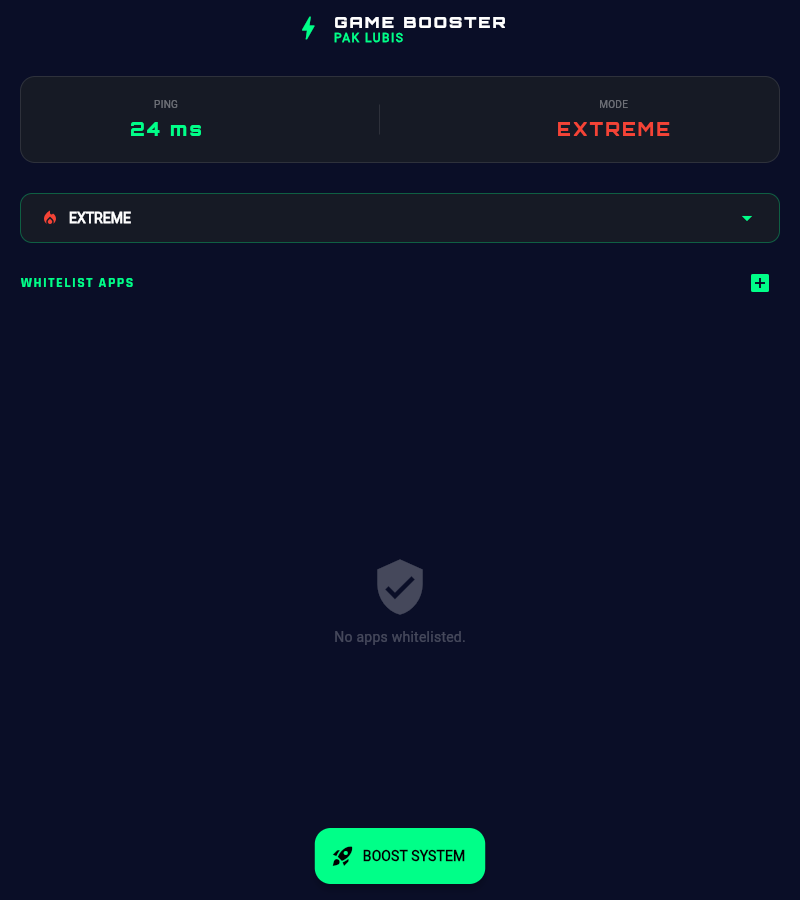
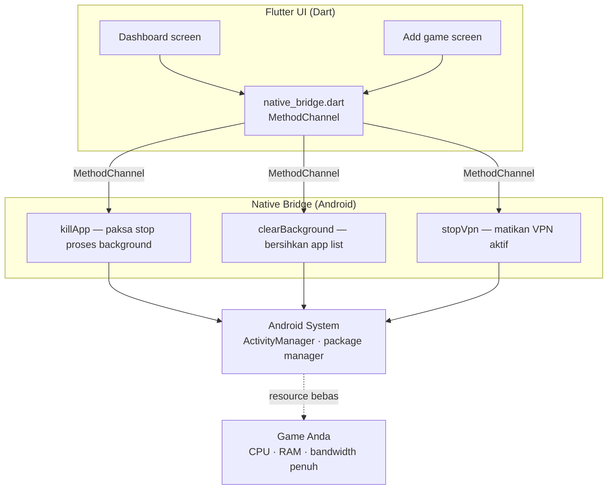

# GameBooster LBS — Game Booster Android dengan Native Bridge

**Bukan cleaner iklan placebo — booster yang benar-benar mematikan proses background lewat native bridge.**

---

## Tampilan

Dashboard utama — status ping, pilihan mode, whitelist aplikasi, dan tombol boost:

---

## Masalahnya

- Gaming di HP menengah-bawah: frame drop karena **puluhan proses background** makan CPU/RAM
- "Game booster" di Play Store mayoritas **placebo** — isinya iklan + fake optimization, tidak menyentuh sistem
- Yang benar-benar bekerja butuh akses **native level Android** — bukan sekadar widget RAM di UI

## GameBooster LBS

Aplikasi Android berbasis **Flutter + native bridge**: pilih game Anda → tap Boost → aplikasi **mematikan proses background yang tidak penting secara paksa** melalui panggilan native, lalu mengalokasikan CPU, RAM, dan koneksi internet murni untuk game.

### Fitur

- **Boost 1-tap** — kill paksa proses background (via native `killApp`), clear aplikasi background (`clearBackground`), stop VPN yang tidak dipakai (`stopVpn`)
- **Manajemen game** — tambahkan game dari daftar aplikasi ter-install (`device_apps`), dashboard game favorit
- **Dashboard status** — kondisi perangkat sebelum/sesudah boost, loading screen ber-tema
- **Permission handler** — alur permintaan izin yang jelas (khususnya untuk akses usage/kill background)
- **UI modern** — Google Fonts, layout rapi, dibangun lintas platform (Android target utama)

---

## Arsitektur

- **Stack:** Flutter 3 (Dart SDK 3) · native bridge Android · `device_apps` (enumerasi aplikasi) · `permission_handler` · `shared_preferences` · `google_fonts`
- **Filosofi:** UI ringan di Flutter, pekerjaan berat di **lapisan native** — bukan fake-optimasi berbasis widget

---

## English

**GameBooster LBS** is an Android game booster that actually terminates background processes through a native bridge, rather than showing a placebo "cleaner" animation.

It targets mid-range phones where background apps, not the game, are the bottleneck.

The source code is not published; this repository documents the product.

---

## Tentang Source Code

Repository ini adalah **showcase** — dokumentasi produk, bukan kode sumber.
Source code GameBooster LBS tidak dipublikasikan dan semua hak dilindungi. Lihat [`LICENSE`](LICENSE).

> Demo, kolaborasi, atau lisensi? Hubungi [Kandar Lubis](https://github.com/kandarlubis31).

---

© 2026 Kandar Lubis — All Rights Reserved.
